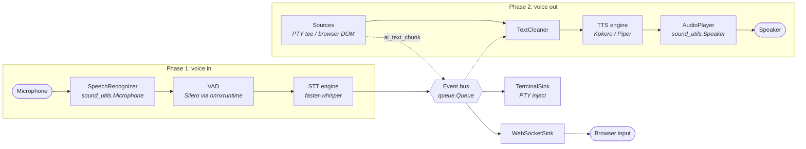
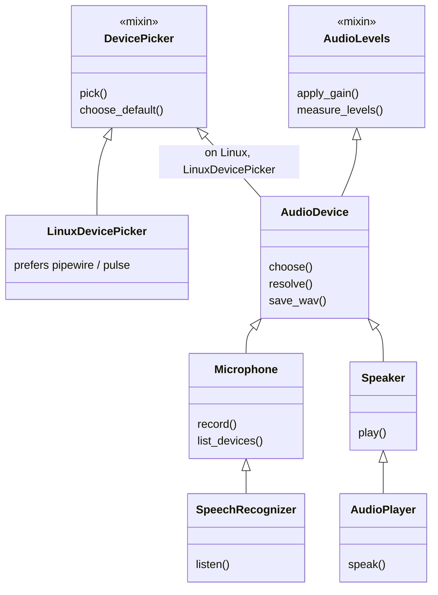

# Architecture



How the shared `sound_utils` classes fit together (the recogniser and player are the only ones `main.py` sees):



The app runs as a few plain threads (mic, recogniser, server); the packages talk through a small event bus built on thread-safe `queue.Queue`. Events: `partial_text`, `final_text`, `speech_start`, `speech_end`, `ai_text_chunk`.

### Recognition threads and the two queues

Whisper takes from 0.3 s (GPU) to over a second (CPU) per utterance, so it runs on its own thread, the `TranscriptionWorker`. The microphone loop only appends audio and puts jobs on two queues, so it never waits and no audio is lost.

```mermaid
flowchart LR
    subgraph Main["Main thread: microphone loop (never waits for Whisper)"]
        direction TB
        Mic([Microphone]) --> VAD["VAD + UtteranceSegmenter<br/><i>start, end, 15 s limit</i>"]
        VAD --> Buf["current utterance audio<br/><i>0.3 s pre-roll + blocks so far</i>"]
    end

    Buf -- "utterance ended:<br/>submit_final(all audio)" --> FQ[["finals queue<br/><i>unbounded, in order,<br/>never dropped</i>"]]
    Buf -. "every 700 ms while speaking:<br/>submit_partial(last 8 s)<br/><i>(0 = off)</i>" .-> PQ[["partials queue<br/><i>holds 1: a newer job<br/>replaces the waiting one</i>"]]

    FQ --> Wake{{"has_work event"}}
    PQ --> Wake
    Wake --> W

    subgraph Worker["Worker thread (the only caller of Whisper)"]
        W["loop: finals first,<br/>then the partial"] --> Whisper["WhisperEngine.transcribe"]
    end

    Whisper -- "final text" --> Bus{{"Event bus"}}
    Whisper -. "partial text" .-> Bus
    Bus --> Out["FinalText / PartialText<br/><i>terminal, sinks, logger</i>"]
```



The queues and the rules for which job comes next are in `job_queues.py` (`JobQueues`); `transcription_worker.py` is only the thread and the error handling.

Rules the worker follows:
- **Finals are never lost.** They are handled in order, and always before a waiting partial.
- **Only the newest partial matters.** A partial is a live caption that is redone from scratch each time, so an older waiting one is replaced by a newer one. This keeps text from lagging when Whisper is slower than the 700 ms interval (likely on the CPU).
- **A final cancels a waiting partial.** The final text replaces the caption, so a stale partial must not show up after it.
- **One bad job does not stop the thread.** A failed transcription is logged (audio size only, never audio or text) and the next job runs.
- **Waking up.** A thread can only block on one thing, so both queues set one `threading.Event` (`has_work`) and the worker sleeps on that. The event is set after the job is queued and cleared before the queues are checked, so no job can arrive unnoticed.
- **Shutdown.** `stop()` queues a stop marker behind the finals, so every final already submitted is transcribed first. A partial still waiting is dropped. The thread is a daemon, so a crash in the main loop cannot hang the exit.
- **One thread, one model.** A second worker thread would need its own Whisper model or would compete for the same one, which would slow down finals.

The recogniser asks for a partial every `PARLAI_PARTIAL_INTERVAL_MS` while an utterance is in progress (counted in audio blocks, not wall-clock time), over the last `PARLAI_PARTIAL_WINDOW_MS` of it. `text_delivery/console_display.py` redraws the terminal line with each `PartialText` and replaces it with the `FinalText`; `main.py` reads one inbox of all events so a partial can never show after its final.

## Packages (in `src/`)
Each package does one job and does not orchestrate. The root `main.py` is the main loop that wires them together. Packages and modules exist as docstring-only placeholders; each is filled in at its milestone.

| Package | Job | Interface | Starts at |
|---|---|---|---|
| `config` | settings from environment variables (`PARLAI_*`, incl. optional `PARLAI_INPUT_DEVICE`, `PARLAI_INPUT_GAIN`, `PARLAI_PLAYBACK_GAIN`, `PARLAI_UTTERANCE_SILENCE_MS`, `PARLAI_UTTERANCE_MAX_MS`, `PARLAI_PARTIAL_INTERVAL_MS`, `PARLAI_PARTIAL_WINDOW_MS`, `PARLAI_WHISPER_MODEL`, `PARLAI_WHISPER_DEVICE`, `PARLAI_LOG_DIR`, `PARLAI_LOG_LEVEL`, `PARLAI_LOG_MAX_MB`, `PARLAI_LOG_KEEP_DAYS`, `PARLAI_LOG_CONSOLE_LEVEL`, `PARLAI_LOG_NAME`, `PARLAI_LOG_FORMAT`, `PARLAI_LOG_QUIET_LOGGERS`), validated at startup against coded rules in `config/rules.py` | `load_settings(env) -> Settings` | M1 |
| `sound_utils` | shared sound I/O: `Microphone`/`Speaker` (both an `AudioDevice`: choose + probe a device), gain and dBFS levels (`AudioLevels` mixin) and per-OS default-device rules (`DevicePicker` mixin: Linux prefers PipeWire/Pulse plugins, others trust PortAudio), `save_wav` on every device. Reused by speech_to_text and text_to_speech | `Microphone(settings).record(s)`, `Speaker(settings).play(audio)` | M1 |
| `speech_to_text` | `SpeechRecognizer` (a `Microphone` plus the pipeline: each block goes through the `Vad` into the `UtteranceSegmenter`, audio is buffered with about 0.3 s of pre-roll, and when an utterance ends (silence, or the `PARLAI_UTTERANCE_MAX_MS` limit, which cuts a long utterance and carries on) its audio goes to a `TranscriptionWorker` (own thread, `queue.Queue`) that runs Whisper and publishes `FinalText`, so the mic loop never waits for Whisper; call `start()` before and `stop()` after; `listen(s) -> str` for a fixed-length recording), `Vad` (Silero via onnxruntime), `WhisperEngine` (faster-whisper, GPU or CPU; before trying the GPU it preloads the `cuda` extra's CUDA libraries via `cuda_libraries.py`, model loaded and downloaded at startup via `prepare()`) | `STTEngine.transcribe_stream(audio_chunks) -> AsyncIterator[Transcript]` | M1 |
| `event_logger` | JSON or plain-text log lines (`json_log`, `text_log`), daily files with size cleanup (`log_files`), logging setup (`logging_setup`), an `EventLogger` thread that logs every event on the bus via `subscribe_all()` (`bus_logger`), and startup/exit/crash lines (`lifecycle`). `FinalText` is logged as a character count at INFO, the text only at DEBUG | `setup_logging(settings)`, `EventLogger(bus).start()` | M1 |
| `event_bus` | small thread-safe bus the others talk through | `publish(event)`, `subscribe()` | M3 |
| `text_delivery` | sinks: PTY injection, WebSocket to browser | `Sink.emit(event)` | M3 |
| `text_to_speech` | `AudioPlayer` (a `Speaker` plus the TTS engine: `speak(text)`), text cleaning | `TTSEngine.synthesize(text) -> AsyncIterator[bytes]` | M6 |
| `ai_output_capture` | sources: PTY tee, browser DOM | `Source` yields AI output text | M6 |

## Layout
```
parlai/
├── CLAUDE.md
├── docs/
├── pyproject.toml
├── main.py                 # main loop; run with `uv run python main.py`
├── src/
│   ├── config/             # settings (load), audio_settings, speech_settings, log_settings, parsers, rules
│   ├── sound_utils/        # audio_device (base), device_picker (choice + per-OS defaults), audio_levels (mixin), microphone, speaker
│   ├── speech_to_text/     # recognizer (wiring), block_timing, utterance_buffer, utterance_segmenter, voice_activity_detection, transcription_worker, job_queues, whisper_engine, model_files, cuda_libraries, cuda_library_names
│   ├── event_bus/          # events, bus
│   ├── event_logger/       # json_log, log_files, logging_setup, bus_logger, lifecycle
│   ├── text_delivery/      # terminal_sink, websocket_sink
│   ├── text_to_speech/     # text_cleaner, tts_engine, audio_player
│   └── ai_output_capture/  # terminal_source, browser_source
├── web/                    # minimal HTML client and test page (M3)
└── tests/
```

Each new package must be added to `packages = [...]` under `[tool.hatch.build.targets.wheel]` in `pyproject.toml`, then `uv sync`. Plain `python3 main.py` fails because the system Python can't see the venv; use `uv run` or the `.venv` interpreter.

## Building binaries
PyInstaller (a dev-only dependency) bundles Python and the app into a folder you can run without installing anything but the system sound libraries (see the README for what each OS needs). It cannot cross-compile, so each OS builds on its own OS.

- Local build: `uv run pyinstaller --noconfirm --distpath dist --workpath build packaging/parlai.spec`, then run `dist/parlai/parlai`.
- CI: `.github/workflows/release.yml` is the only workflow and is manual. You give it an existing tag and tick Linux and/or Windows. A `plan` job checks the tag exists and builds the matrix from the ticked boxes, `build` makes each binary from that tag on its own OS (`ubuntu-22.04`, `windows-latest`), and `release` creates the GitHub Release with the archives attached.
- The Linux build is made on Ubuntu 22.04 on purpose: a binary needs a glibc at least as old as the target, and a build on a rolling distro such as Arch would not start on older Debian.
- `packaging/parlai.spec` also bundles faster-whisper's data files (the Silero VAD model) and the package metadata the startup log reads versions from. It strips the system sound libraries (`libportaudio`, `libasound`, `libjack`, `libdb`) from the Linux bundle, so the app uses the user's own audio stack. Windows keeps the PortAudio DLL because it ships inside the `sounddevice` wheel and Windows has no system copy.

## Milestones
1. **M0:** project scaffold (`uv init`, deps, CLI skeleton).
2. **M1:** mic capture, VAD and faster-whisper print finals to stdout.
3. **M2:** partial results (rolling-window re-transcription).
4. **M3:** WebSocket server and an HTML page where the input fills live.
5. **M4:** PTY wrapper that injects text into a CLI (e.g. `python main.py run -- claude`).
6. **M5:** push-to-talk, mute, auto-submit.
7. **M6 (Phase 2):** PTY output tee, text cleaner, TTS playback, barge-in.
8. **M7 (optional):** speaker verification, browser extension for arbitrary pages.
9. **M8 (UI, not scheduled):** a desktop UI for people who do not use a console: status (loading, ready, listening, transcribing, CPU or GPU), live transcript, microphone picker with level meter, settings, an "Enable GPU" button and a diagnostics tab. Framework not chosen (local web UI in a WebView2 shell versus Qt). Small console fixes from the first Windows test (startup progress, visible CPU-fallback message) come before it and do not need the UI.

## Conventions
- Python 3.12, type hints, `ruff` for lint and format.
- Threads and `queue.Queue`, no asyncio unless a real need appears. Keep the audio callback thread free of blocking work and hand off via queues.
- Never log raw audio or transcripts at INFO level.
- Commands: `uv sync`, `uv run python main.py`, `uv run pytest`, `uv run ruff check .`
